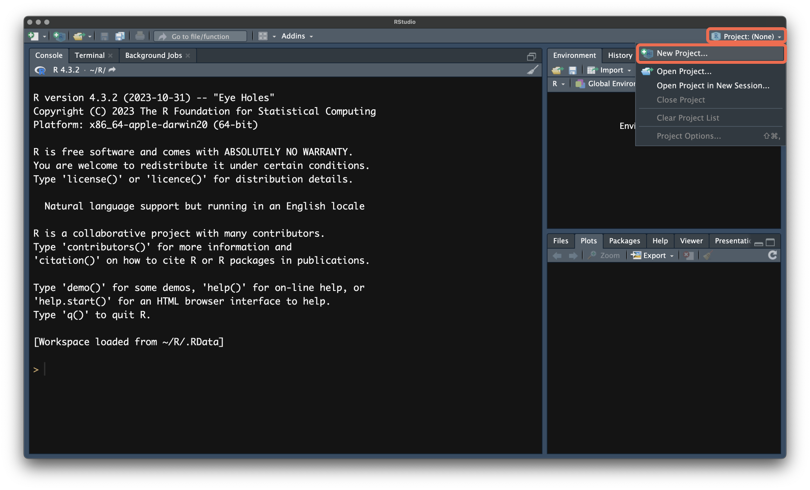
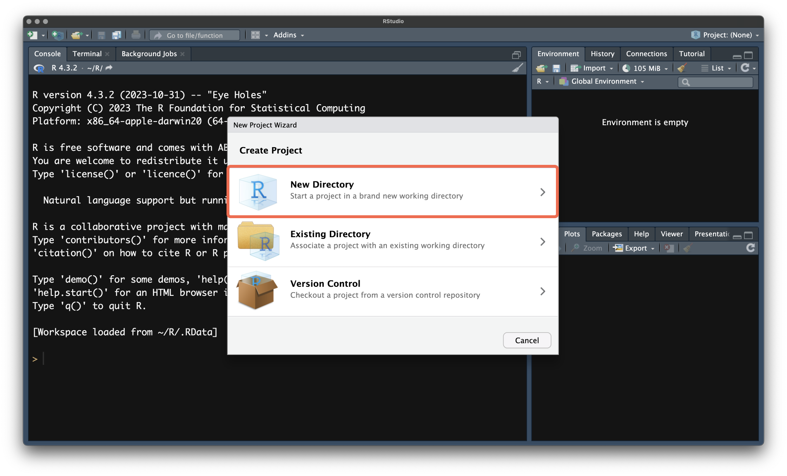
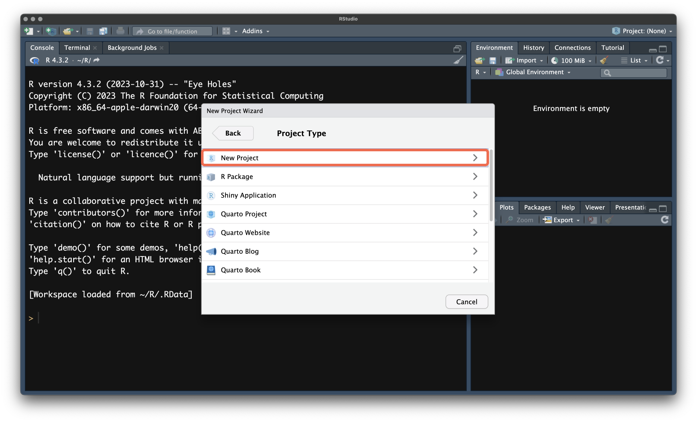
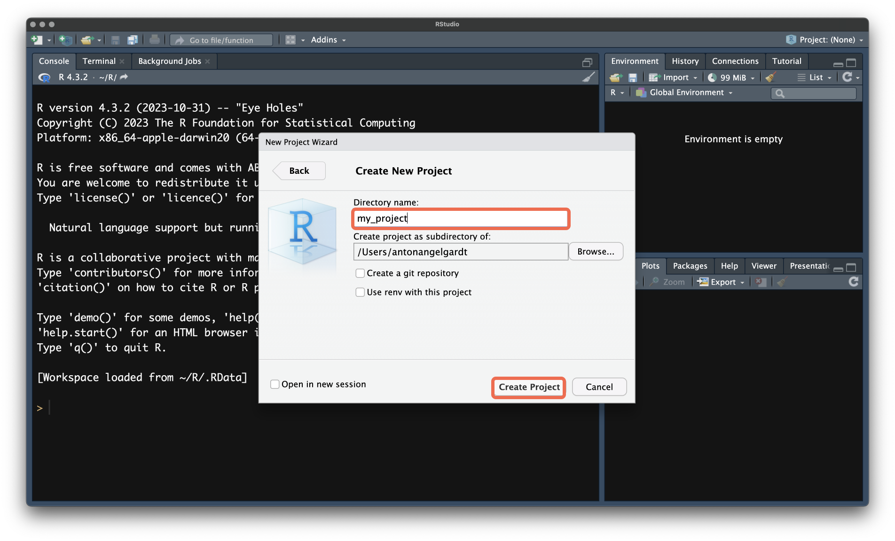
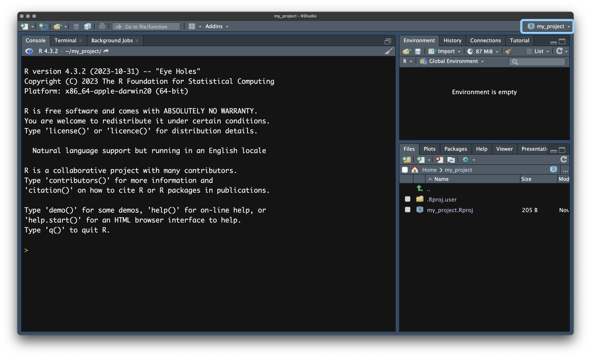

# Базовое исследование данных {#rpy-data}

```{r opts, echo=FALSE, eval=TRUE}
knitr::opts_chunk$set(echo = TRUE, eval = TRUE, warning = FALSE, message = TRUE, error = FALSE)
```


:::{.intro}
Изучая [базовый R](rpy-basics.qmd), мы создавали данные сами, однако в реальной жизни данные приходят к нам откуда-то снаружи: из программы, где мы кодили эксперимент, от платформы онлайн-опросника, из таблицы, которую коллега выгрузил из какой-то системы. Наша задача --- научиться грузить такие данные в R и понимать, что именно мы забрали.
:::

## Дополнительные пакеты {#data-pkgs}

Хотя возможности базового R велики, синтаксис его бывает не всегда прост. Хотелось бы писать код на более понятном и удобном диалекте, да и расширить базовые возможности для анализа данных тоже было бы неплохо --- для этого существуют дополнительные пакеты.

По своей сути пакет являются просто набором функций. Аналогично и базовый R состоит из набора пакетов (`base`, `stats`, `utils` и др.). Первым пакетом, с которым мы познакомимся, будет [`tidyverse`](https://tidyverse.org/).


### Установка пакетов {#data-pkgs-install}

Чтобы иметь доступ к функциям пакета, его надо скачать. Делается это с помощью команды `install.packages()`, которой нужно передать название пакета как строку (в кавычках):

```{r instl-pkgs, eval=FALSE}
install.package("tidyverse")
```

Команда начнет устанавливать пакеты и зависимости --- это занимает некоторое время. Обычно всё проходит достаточно успешно.

:::{.callout-tip title="Зависимости"}

Обычно, зависимости --- другие пакеты, которые необходимы данному для работы --- ставятся вместе с пакетом. Но иногда --- нет. Есть способ указать, что все зависимости тоже необходимо скачать:

```{r instl-deps, eval=FALSE}
install.package("tidyverse", dependencies = TRUE)
```

Это может помочь, если пакет, кажется, установился, но всё равно не работает.
:::

:::{.callout-tip title="Зеркала"}

Иногда бывает, что [главный репозиторий](https://cloud.r-project.org/), откуда по умолчанию скачиваются и ставятся пакеты, недоступен, из-за чего процесс установки падает.

Тогда можно задать зеркало, с которого `install.packages()` будет скачивать пакеты. Список зеркал можно найти [здесь](https://cran.r-project.org/mirrors.html). Ссылка на зеркало необходимо указать как строку в аргумент `repos`:

```{r instl-mirrors, eval=FALSE}
## пример с одним из зеркал

install.package("tidyverse", repos = "https://mirrors.bfsu.edu.cn/CRAN/")
```

Если выбранное вами зеркало так же не работает, попробуйте ещё несколько. Обычно за 2--3 попытки находится функционирующее.

:::


### Подключение пакетов {#data-pkgs-library}

Когда пакет скачан, его необходимо подключить к текущей сессии работы в R, прописав

```{r pkgs}
library(tidyverse)
```

Рекомендуется прописывать все подключения пакетов в начале скрипта, чтобы было сразу видно, какие пакеты используются. Если функция `library(tidyverse)` вернула в консоль такой же результат, как выше, значит все установилось корректно.


## Наши данные: эксперимент `sharexp` {#data-sharexp}

Ближайшие несколько глав мы будем работать с данными реального эксперимента. Ниже представлено их описание.

:::{.callout-note title="SHAREXP | Codebook"}

### Описание эксперимента {.unnumbered #sharexp-codebook-description}

В исследовании изучался зрительный поиск иконок различных платформ смартфонов.

> Цель исследования: выяснить, какая иконка «поделиться» (share) обознается лучше --- быстрее и точнее.

Испытуемым необходимо было искать иконки поделиться (share) iOS и Android среди дистракторов --- других иконок, которые для обеих платформ отрисованы одинаково.

**Независимые переменные исследования**:

- тип иконки --- иконка iOS (Outgoing Tray) и иконка Android (Three Dots)
- количество стимулов в пробе --- 8, 12, 16
- используемая платформа смартфона --- iOS или Android

Последняя переменная является квазиэкспериментальной.

В дизайн эксперимента были включены пробы с одним целевым стимулом (Outgoing Tray *или* Three Dots) и с двумя целевыми стимулами (*и* Outgoing Tray, *и* Three Dots)

**Зависимые переменные исследования**:

- время поиска целевого стимула (время реакции) --- от начала пробы до клика испытуемого
- точность поиска целевого стимула --- рассчитываемая через координаты клика


### Датасеты {.unnumbered}

#### `sharexp_raw.zip` {.unnumbered #sharexp-codebook-raw}

[Архив](https://github.com/angelgardt/rs-app-andan-book/raw/refs/heads/master/data/sharexp/sharexp_raw.zip) содержит аутпуты PsychoPy для каждого испытуемого. Все аутпуты генерируется программно и имеют одинаковую структуру.

> Скачать архив можно [по ссылке](https://github.com/angelgardt/rs-app-andan-book/raw/refs/heads/master/data/sharexp/sharexp_raw.zip).

Датасет содержит следующие переменные:

|Переменная|Значения|Описание|
|:---|:---|:---|
|`stim1`---`stim16`|Строка|Название графического файла со стимулом|
|`pos1`---`pos16`|Пара числовых значений|Позиция стимула на экране|
|`size1`---`size16`|Пара числовых значений|Размер стимула|
|`ok`|Строка|Название графического файла с кнопкой `OK`|
|`posok`|Пара числовых значений|Позиция кнопки `OK`|
|`sizeok`|Пара числовых значений|Размер кнопки `OK`|
|`numtrial`|Число|Номер пробы|
|`setsize`|Число (`8`, `12`, `16`)|Количество стимулов в пробе|
|`trialtype`|`tray` --- Outgoing Tray<br>`dots` --- Three Dots<br>`both` --- два целевых стимула|Тип пробы (целевой стимул)|
|`mouse_main1.time_raw`|Число|Время до первого клика (сек)|
|`mouse_main1.x_raw`|Число|Горизонтальная координата первого клика (px)|
|`mouse_main1.y_raw`|Число|Вертикальная координата первого клика (px)|
|`mouse_main2.time_raw`|Число|Время до второго клика (сек)|
|`mouse_main2.x_raw`|Число|Горизонтальная координата второго клика (px)|
|`mouse_main2.y_raw`|Число|Вертикальная координата второго клика (px)|
|`order`|Число|Порядок предъявления проб в конкретной сессии|

Переменные, отсутствующие в списке, не являются существенными для анализа и несут, скорее, техническую информацию.


> **NB!** В последних строках каждого файла записана социально-демографическая информация об испытуемом и техническая информация о сессии эксперимента.

#### `targetpositions.xlsx` {.unnumbered #sharexp-codebook-targets}

Датасет содержит информацию о координатах целевых стимулов и диапазонах координат, в пределах которых клик считается корректным. У колонок, относящихся к тренировочной серии, в названии содержится аффикс `tr`.

> Скачать файл можно [по ссылке](https://github.com/angelgardt/rs-app-andan-book/raw/refs/heads/master/data/sharexp/targetpositions.xlsx).

|Переменная|Значения|Описание|
|:---|:---|:---|
|`posx1`|Число|Позиция первого целевого стимула по горизонтальной оси|
|`posy1`|Число|Позиция первого целевого стимула по вертикальной оси|
|`posxmin1`|Число|Минимальная координата клика по горизонтальной оси для первого целевого стимула|
|`posxmax1`|Число|Максимальная координата клика по горизонтальной оси для первого целевого стимула|
|`posymin1`|Число|Минимальная координата клика по вертикальной оси для первого целевого стимула|
|`posymax1`|Число|Максимальная координата клика по вертикальной оси для первого целевого стимула|
|`posx2`|Число|Позиция второго целевого стимула по горизонтальной оси|
|`posy2`|Число|Позиция второго целевого стимула по вертикальной оси|
|`posxmin2`|Число|Минимальная координата клика по горизонтальной оси для второго целевого стимула|
|`posxmax2`|Число|Максимальная координата клика по горизонтальной оси для второго целевого стимула|
|`posymin2`|Число|Минимальная координата клика по вертикальной оси для второго целевого стимула|
|`posymax2`|Число|Максимальная координата клика по вертикальной оси для второго целевого стимула|
|`numtrial`|Число|Номер пробы|

Значения в колонках `numtrial` из `sharexp_raw` и `numtrial` из `targetpositions` заданию одни и те же экспериментальные пробы.


#### `share_platform.csv` {.unnumbered #sharexp-codebook-platform}

Датасет содержит информацию об используемой респондентом платформе.

> Данные расположены [по ссылке](https://raw.githubusercontent.com/angelgardt/rs-app-andan-book/refs/heads/master/data/sharexp/share_platform.csv), но **скачивать их в виде файла не нужно**. Мы вопспользуемся далее другим способом.

Датасет содержит следующие переменные:

|Переменная|Значения|Описание|Примечание|
|:---|:---|:---|:---|
|`id`|Число|Идентификатор испытуемого|Совпадает с названием файла в `sharexp_raw.zip`|
|`platform`|`ios` --- iOS<br>`andr` --- Androind|Платформа смартфона испытуемого||

:::

<!---
> В исследовании изучался зрительный поиск иконок «поделиться» (share), которые используются в смартфонах на разных платформах. Испытуемые искали иконку iOS или иконку Android среди дистракторов --- других иконок, нарисованных одинаково для обеих платформ. Нас интересует, какая иконка узнаётся быстрее и точнее.

Структура эксперимента такая:

- в каждой пробе на экране предъявлялось 8, 12 или 16 стимулов (`setsize`);
- целевой стимул мог быть иконкой iOS (`tray`), иконкой Android (`dots`) или в пробе присутствовали обе иконки сразу (`both`) --- это тип пробы (`trialtype`);
- испытуемый должен был найти иконку и кликнуть по ней мышью;
- всего каждый из 20 испытуемых прошёл 450 проб;
- кроме того, мы знаем, смартфоном какой платформы пользуется испытуемый --- iOS или Android. Эту переменную исследователь не назначал испытуемым, он только фиксировал её.

Время до клика и координаты клика записывала экспериментальная программа PsychoPy, поэтому устроены данные так, как удобно ей, а не нам. В этом и состоит основная трудность: **данные почти никогда не приходят в том виде, в котором с ними удобно работать**.

:::{.callout-note}
Полное описание всех файлов и переменных находится в кодбуке --- файле `sharexp_codebook` в папке `data/sharexp` [репозитория учебника](https://github.com/angelgardt/rs-app-andan-book/tree/master/data/sharexp). Привычка заглядывать в кодбук перед работой с данными --- одна из самых полезных.
:::
--->

Данные в архиве `sharexp_raw.zip` лежат в нескольких файлах: `01.csv`, …, `20.csv`, по одному на каждого испытуемого, аутпуты PsychoPy. Ближайшей нашей задачей будет объединить их в один, чтобы мы могли работать с данными всех испытуемых. Кроме того, `targetpositions.xlsx` --- это Excel-файл, и видимо, его придется обрабатывать как-то специфически.

Ну, ладно. Нам бы хоть один файл сейчас прочитать, и чтобы это осуществить, надо разобраться, какие форматы файлов данных существуют.


## Форматы файлов с данными {#data-formats}

:::{#def-file-format}
**Формат файла (file format)** --- способ, которым данные записаны в файле. От формата зависит, чем и как этот файл можно прочитать.
:::

Для нас важно различать два больших класса форматов.

**Текстовые форматы** --- это обычный текст, который можно открыть в любом текстовом редакторе (хоть в блокноте) и увидеть данные «невооружённым глазом». Значения в таких файлах отделены друг от друга специальным символом --- *разделителем (delimiter)*.

- **CSV (Comma-Separated Values)** --- значения разделены запятыми (`,`). Расширение `.csv`.
- **TSV (Tab-Separated Values)** --- значения разделены знаком табуляции (`\t`). Расширение `.tsv`.
- **TXT** --- просто текст. Разделителем может быть что угодно: пробел, точка с запятой, вертикальная черта.

**Бинарные форматы** --- файлы, внутри которых лежат не текст, а закодированные данные. Блокнотом такой файл открыть бессмысленно --- увидите «кракозябры». Чтобы открыть, нужна программа, которая понимает этот формат.

- **Excel** --- `.xlsx` (и устаревший `.xls`). Внутри может быть несколько листов.
- **SPSS** --- `.sav`. Встречается всё реже, но ещё может вам попасться, так как SPSS широко использовался многими исседователями некоторое время назад. Такие файлы хранят не только числа, но и подписи к переменным и значениям.
- **R** --- `.rds` и `.RData`. Объекты R, сохранённые «как есть».


:::{.callout-warning}
### Расширение файла ничего не гарантирует

Расширение --- это просто часть имени файла. Оно *подсказывает*, как устроено содержимое, но не *гарантирует* этого. В файлах с расширением `.csv` разделителем может оказаться и запятая, и точка с запятой, и пробел. Поэтому прежде чем читать файл, его полезно открыть и посмотреть глазами.
:::

### Десятичные разделители и «русский» CSV {#data-decimal}

Отдельная неприятность --- десятичный разделитель. В англоязычных странах дробная часть отделяется точкой (`3.14`), в России --- запятой (`3,14`). Если на русскоязычном компьютере сохранить таблицу из Excel в CSV, получится файл, где:

- десятичным разделителем будет запятая;
- а значения между собой --- разделены точкой с запятой (иначе запятая-десятичный и запятая-разделитель перепутались бы).

Поэтому в функциях для чтения данных два «CSV»: стандартный и «европейский».

### Форматы с особой разметкой {#data-markup}

Реже, главным образом при работе с данными из интернета, встречаются форматы **JSON** и **XML**. Они хранят данные в виде вложенной структуры (чем-то похожей на списки в R). Для чтения JSON пригодится пакет `jsonlite`, для XML --- пакет `xml2`. В нашем курсе они нам не понадобятся, но знать о них полезно: если вам когда-нибудь придёт файл с расширением `.json`, это не повод паниковать.


## Организация рабочего пространства {#data-workspace}

Прежде чем читать файл, нужно сказать R, где он находится. И здесь нас ждёт один из главных источников ошибок у начинающих.

### Рабочая директория {#data-wd}

:::{#def-wd}
**Рабочая директория (working directory)** --- папка, в которую по умолчанию «смотрит» R, когда ищет файлы или сохраняет их.
:::

Узнать, какая папка сейчас является рабочей, можно командой:

```{r getwd, eval=FALSE}
getwd()
```

Изменить рабочую директорию можно командой `setwd()`:

```{r setwd, eval=FALSE}
setwd("/Users/student/Documents/andan")
```

Однако пользоваться `setwd()` в скриптах **не стоит**. Путь, который вы вписали, существует только на вашем компьютере. Стоит отправить скрипт коллеге (или преподавателю на проверку), и код сломается: у коллеги и преподавателя нет папки `/Users/student/Documents/andan`. Мы будем решать эту проблему другим способом --- с помощью проектов, о которых чуть ниже.

### Путь к файлу {#data-path}

:::{#def-path}
**Путь к файлу (file path)** --- адрес, по которому в файловой системе находится файл.
:::

Пути бывают двух видов.

- **Абсолютный путь** описывает расположение файла от «корня» файловой системы:
  - на UNIX-подобных системах (Linux, macOS) --- нечто типа `/Users/student/Documents/andan/data/sharexp/raw/01.csv`
  - на Windows --- что-то вроде `C:/Users/student/Documents/andan/data/sharexp/raw/01.csv`).
- **Относительный путь** описывает расположение файла от рабочей директории: `data/sharexp/raw/01.csv`.

Относительные пути короче и, главное, не зависят от компьютера. Если у вас и у вашего коллеги одинаково устроена *внутренняя* структура папок, то один и тот же относительный путь сработает у обоих.

:::{.callout-tip title = "Полезные вещи про пути"}

- Внутри пути папки разделяются прямым слэшем `/`. Обратный слэш `\` (стандартный в Windows) в R нужно удваивать `\\`, так как для R он служебный символ. Проще всегда писать `/` --- R поймёт это на любой операционной системе.
- `..` означает «подняться на один уровень вверх». Путь `../data/file.csv` означает «выйти из текущей папки и найти в соседней папке `data` файл `file.csv`».

:::


### RStudio Projects {#data-projects}

Чтобы не мучиться с рабочей директорией и путями, в RStudio есть **проекты (projects)**.

:::{#def-project}
**Проект RStudio** --- это папка, которую RStudio «запоминает» как единое рабочее пространство для одного исследования или задачи. При открытии проекта рабочая директория автоматически устанавливается в эту папку.
:::

Что это даёт:

- рабочая директория всегда правильная --- вам не нужно ничего устанавливать руками;
- можно использовать короткие относительные пути;
- все файлы одного исследования лежат вместе: данные, скрипты, результаты;
- чтобы код воспроизвёлся на другом компьютере, достаточно отправить коллеге всю папку проекта целиком.

**Как создать проект?**

1. В правом верхнем углу RStudio нажмите на `Project: (None)` и выберите `New Project…`.

{#fig-rproject-1}

2. В открывшемся окне выберите `New Directory`. Эта опция создаст новую папку для проекта.

{#fig-rproject-2}

3. Далее выберите `New Project`.

{#fig-rproject-3}

4. В поле `Directory name` укажите, как будет называться папка проекта. В поле `Create project as subdirectory of:` можно выбрать, внутри какой папки она будет создана. Нажмите `Create Project`.

{#fig-rproject-4}

5. Проект создан и открыт. Чтобы узнать, в каком проекте вы сейчас находитесь, посмотрите в правый верхний угол.

{#fig-rproject-5}

Внутри проекта удобно сразу завести папки, в которых будет порядок:

```
my-project/
├── my-project.Rproj
├── data/        # исходные данные (их не редактируем!)
├── scripts/     # скрипты с кодом
└── output/      # результаты: графики, таблицы
```

:::{.callout-important}
Исходные («сырые») данные --- неприкосновенны. Не правьте их руками в Excel и не пересохраняйте поверх исходных файлов. Всё, что мы делаем с данными, должно делаться *кодом* и сохраняться в *новые* файлы. Тогда любой желающий (включая вас через полгода) сможет воспроизвести путь от сырых данных до результата.
:::

В нашем курсе мы будем исходить из того, что вы работаете внутри проекта, в корне которого находится папка `data`, а в ней --- папка `sharexp` с файлами эксперимента. Поэтому во всех примерах пути будут начинаться с `data/sharexp/`.


## Импорт данных {#data-import}

Теперь, когда мы знаем, где лежат файлы и как на них сослаться, можно их читать.

### Текстовые форматы {#data-import-text}

Для чтения текстовых файлов мы будем использовать функции пакета `readr` (он входит в `tidyverse`). Их имена начинаются с `read_`:

|Функция|Что читает|
|:---|:---|
|`read_csv()`|CSV: разделитель --- запятая, десятичный разделитель --- точка|
|`read_csv2()`|«Европейский» CSV: разделитель --- точка с запятой, десятичный разделитель --- запятая|
|`read_tsv()`|TSV: разделитель --- табуляция|
|`read_delim()`|любой текстовый файл с произвольным разделителем|

: Функции пакета `readr` для чтения текстовых файлов {#tbl-readr}

В базовом R тоже есть функции для чтения данных --- `read.csv()`, `read.table()` и другие, с точкой вместо нижнего подчёркивания. Они делают примерно то же самое, но хуже угадывают типы данных и медленнее работают, поэтому мы предпочитаем `readr`.

Прочитаем файл с платформами. В [кодбуке](#sharexp-codebook-platform) было сказано не скачивать данные как файл, потому что R умеет читать их прямо из интернета. Воспользуемся данной фичей и посмотрии, как она работает.

Судя по [ссылке на данные](https://raw.githubusercontent.com/angelgardt/rs-app-andan-book/refs/heads/master/data/sharexp/share_platform.csv), она ведет к csv-файлу, так как заканчивается на `.csv`. Что ж, прочитаем данные предназначенной для этого функцией:

```{r read-csv-platform}
## читаем данные прямо по ссылке из интернета

read_csv("https://raw.githubusercontent.com/angelgardt/rs-app-andan-book/refs/heads/master/data/sharexp/share_platform.csv")
```

Ну, в общем-то что-то прочиталось, однако если мы внимательно присмотримся к тому, что получилось, мы обнаружим некоторую проблему. Кодбук обещал нам две переменные в этих данных --- `id` и `platform`, однако `read_csv()` нам сообщила, что `Rows: 20 Columns: 1`. Двадцать строк --- это разумно, но вот одна колонка --- что-то не так.

Заметим, что ошибок не было --- файл прочитан. Сделаем важный вывод: **всегда проверяйте результат импорта**, даже если на первый взгляд всё отработало успешно.

Чаще всего проблема в разделителе. Вероятно, в этом csv-файле разделитель не запятая, а что-то иное. В принципе, в нашем случае датасет небольшой, его можно изучить и прямо в консоли, и открыть в текстовом редакторе, чтобы посмотреть, каков разделитель. Но всё же укажем функцию, которая может быть полезна при работе с данными с большим количеством строк. 

```{r read-lines}
readLines("https://raw.githubusercontent.com/angelgardt/rs-app-andan-book/refs/heads/master/data/sharexp/share_platform.csv", n = 10)
```

`readLines()` читает строки файла «как есть», и возвращает строковый вектор. Мы вызвали 10 строк (`n = 10`), и видим, что

- первая строка --- это `"id platform"`, то есть названия колонок, что логично
- вторая --- это `"1 ios"`, то есть платформа для первого испытуемого
- вторая --- это `"2 ios"`, то есть платформа для второго испытуемого
- и т.д.

Можем прямо отсюда скопировать символ, которые разделяет колонки, то есть стоит между, например, `1` и `ios`. В случае файла `share_platform.csv` это пробел. Разделитель, прямо скажем, весьма нетипичный, но такой уж дан файл, придется его грузить.

Для загрузки файла с произвольным разделителем нужна функция `read_delim()`:

```{r read-platform}
platform <- read_delim("data/sharexp/share_platform.csv", delim = " ")
platform
```

Посмотрим на результат внимательно. Функция сама определила, что в файле две колонки: `id` (число, `<dbl>`) и `platform` (текст, `<chr>`).


Теперь прочитаем данные первого испытуемого. Это обычный CSV:

```{r read-01, message=TRUE}
d1 <- read_csv("data/sharexp/raw/01.csv")
```

Функция `read_csv()` не просто прочитала файл, но и отчиталась: сколько строк и столбцов она нашла, какой разделитель использовала, и как определила типы столбцов. Эти сообщения полезно читать --- они первыми сообщают, если что-то пошло не так.

<!---
Что произойдёт, если выбрать «не ту» функцию? Попробуем прочитать наш файл с пробелами как обычный CSV:

```{r read-wrong}
read_csv("data/sharexp/share_platform.csv")
```

Ошибки нет, но результат бесполезен: R увидел одну-единственную колонку с названием `id platform` и в ней строки вида `1 ios`. Это опасная ситуация --- код отработал, а данные прочитаны неправильно.
--->

### Табличные форматы {#data-import-excel}

Файлы Excel читаются функциями пакета `readxl`. Он устанавливается вместе с `tidyverse`, но не подключается автоматически, поэтому подключим его отдельно (либо будем обращаться к функциям через `::`).

```{r readxl-lib}
library(readxl)
```

Основные функции --- `read_xlsx()` для файлов `.xlsx` и `read_xls()` для устаревших `.xls` (`read_excel()` сама определяет формат по расширению). Посмотрим, какие листы есть в файле с координатами целевых стимулов:

```{r excel-sheets}
excel_sheets("data/sharexp/targetpositions.xlsx")
```

В файле два листа. По умолчанию `read_xlsx()` читает первый, но можно указать другой через аргумент `sheet`. Также можно пропустить лишние строки в начале файла (`skip`), указать диапазон ячеек (`range`) и т. д.

```{r read-excel}
targets <- read_xlsx("data/sharexp/targetpositions.xlsx")
targets
```

:::{.callout-note}
### А SPSS?

Файлы SPSS (`.sav`) читаются функцией `read_sav()` из пакета `haven`. Он тоже устанавливается вместе с `tidyverse`:

```{r read-sav, eval=FALSE}
library(haven)
spss_data <- read_sav("data/some_spss_file.sav")
```

Особенность: `haven` сохраняет подписи к переменным и значениям (value labels), и категориальные переменные при этом читаются как специальный тип `haven_labelled`. Чаще всего их удобно сразу перевести в обычные факторы функцией `as_factor()`.
:::

### Тибблы {#data-tibble}

Заметили, что результат вывелся не так, как выводился датафрейм в [прошлой главе](rpy-basics.qmd#dataframes)? Функции `tidyverse` читают данные в особый объект --- **тиббл (tibble)**.

С точки зрения пользователя тиббл --- это почти тот же датафрейм, но с рядом удобных отличий:

- при выводе в консоль большая таблица не заливает весь экран: показывается только её начало (первые 10 строк) и столько столбцов, сколько помещается на экране, остальные перечислены внизу (небольшие таблицы --- до 20 строк --- выводятся целиком);
- под названием каждого столбца подписан его тип (`<dbl>`, `<chr>`, `<lgl>` и т. д.);
- тиббл не меняет без вашего ведома названия столбцов и типы данных.

Всё, что мы умели делать с датафреймами (`$`, индексация и т. д.), работает и с тибблами.


## Первое знакомство с данными {#data-explore}

Данные загружены. Теперь самое важное действие, которое нужно сделать **до** любых преобразований и вычислений: **посмотреть на данные глазами**. Мы должны понять, что у нас есть, прежде чем решать, что с этим делать.

Работать будем с данными первого испытуемого --- объектом `d1`.

### Размер таблицы {#data-explore-size}

Сколько у нас строк и столбцов?

```{r dims}
nrow(d1)   # число строк
ncol(d1)   # число столбцов
dim(d1)    # оба сразу
```

Строк 458, столбцов 91. Помним, что в эксперименте было 450 проб. Откуда 8 лишних строк? Выясним.

### Начало и конец таблицы {#data-explore-headtail}

Функции `head()` и `tail()` показывают первые и последние строки таблицы. Количество строк можно задать аргументом `n`.

```{r head}
head(d1, n = 3)
```

Столбцов много, и тиббл показывает только то, что влезло на экран. Ограничим вывод несколькими важными столбцами. Для этого воспользуемся индексацией по именам:

```{r head-cols}
d1[1:3, c("numtrial", "trialtype", "setsize", "mouse_main1.time_raw")]
```

Это и есть наши интересные переменные: номер пробы (`numtrial`), тип пробы (`trialtype`), количество стимулов (`setsize`) и время до первого клика (`mouse_main1.time_raw`).

А теперь посмотрим на конец таблицы:

```{r tail}
tail(d1[, c("stim1", "stim2", "numtrial", "trialtype", "mouse_main1.time_raw")], n = 10)
```

Вот и разгадка. Последние строки уже не относятся к пробам: в них нет ни номера пробы, ни типа, ни времени, зато есть пара «название --- значение» (`age` --- `19`, `date` --- `2019_Jan_14_1038`, …). Это служебная информация о сессии, которую PsychoPy дописывает после всех проб, отделив их пустой строкой. Нам этот «довесок» в таблице проб не нужен --- но мы это обнаружили только потому, что посмотрели на данные.

:::{.callout-important}
Привычка **смотреть на начало и конец** данных очень полезна. Ошибки при чтении --- лишние строки, заголовки в середине таблицы, пустые строки --- чаще всего прячутся именно там.
:::

### Структура данных {#data-explore-structure}

Функция `str()` показывает структуру объекта: размер, названия столбцов, их типы и первые значения. Для широкой таблицы вывод получится очень длинным, поэтому возьмём лишь часть столбцов:

```{r str}
str(d1[, c("numtrial", "trialtype", "setsize",
           "mouse_main1.time_raw", "mouse_main1.x_raw", "mouse_main1.y_raw")])
```

Аналогичную, но более компактную сводку даёт функция `glimpse()` из `tidyverse`:

```{r glimpse}
d1 |>
  select(numtrial, trialtype, setsize, mouse_main1.time_raw) |>
  glimpse()
```

Здесь мы воспользовались функцией `select()` и оператором `|>` (пайп) --- о них поговорим в [следующей главе](rpy-tidybase.qmd). Пока достаточно знать, что `select()` выбирает нужные столбцы, а пайп передаёт результат в следующую функцию.

Обратим внимание на типы: `numtrial` и `setsize` --- числа (`<dbl>`), `trialtype` --- текст (`<chr>`). С числами всё нормально, а вот `trialtype` --- это номинальная переменная с тремя значениями, и со временем мы научимся записывать её иначе, чем «текст».

### Описательная сводка {#data-explore-summary}

Функция `summary()` для числовых переменных выдаёт минимум, максимум, квартили, среднее и количество пропусков, а для текстовых --- только длину и тип:

```{r summary}
summary(d1$mouse_main1.time_raw)
summary(d1$trialtype)
```

Время до клика лежит в пределах от 0.74 до 5.82 секунд, при этом среднее (1.72) выше медианы (1.49) --- похоже, что есть небольшое число очень долгих проб, которые «тянут» среднее вверх. К вопросу о том, как с этим быть, мы вернёмся, когда будем говорить об описательных статистиках.

Обратите внимание на `NA's: 8` в первой сводке --- восемь пропущенных значений во времени до клика. Это ровно те 8 лишних строк из конца файла.

### Категориальные переменные {#data-explore-categorical}

Для номинальных переменных полезно знать, какие значения встречаются и сколько раз. Для этого есть две функции.

`unique()` возвращает все различные значения:

```{r unique}
unique(d1$trialtype)
unique(d1$setsize)
```

Здесь заметно, что в `trialtype` есть пропуск `NA` (откуда он, мы уже знаем). `table()` строит **таблицу частот**: сколько раз встретилось каждое значение:

```{r table}
table(d1$trialtype)
```

Функция умеет считать и сочетания значений двух переменных --- такая таблица называется **таблицей сопряжённости**:

```{r table2}
table(d1$trialtype, d1$setsize)
```

Каждое сочетание типа пробы и числа стимулов встретилось 50 раз --- так и задумывалось в дизайне эксперимента: $3 \times 3 \times 50 = 450$. Хороший знак. Если бы мы увидели здесь что-то неожиданное (скажем, 49 вместо 50), это был бы повод задуматься, не потерялась ли часть данных.

### Пропущенные значения {#data-explore-na}

Мы уже видели, что в данных есть пропуски. Выясним, сколько их и где. Функция `is.na()` возвращает вектор из `TRUE` и `FALSE`: `TRUE` там, где значение пропущено. Поскольку `TRUE` при вычислениях превращается в `1`, а `FALSE` --- в `0`, то сумма этого вектора --- количество пропусков:

```{r na-count}
sum(is.na(d1$mouse_main1.time_raw))
```

Пропусков в одной переменной мы теперь считать умеем. А как посчитать пропуски в каждом столбце сразу? Для этого можно применить `is.na()` ко всей таблице сразу --- получится таблица из `TRUE` и `FALSE` --- и просуммировать её по столбцам функцией `colSums()`:

```{r na-colsums}
na_by_col <- colSums(is.na(d1))
na_by_col[c("numtrial", "trialtype", "setsize",
            "mouse_main1.time_raw", "mouse_main1.x_raw", "mouse_main1.y_raw")]
```

В этих столбцах по 8 пропусков --- в точности по числу служебных строк. Теперь понятно, что пропуски в данных не случайны --- они имеют техническое происхождение. Это важный вывод. Как мы с ними поступим, зависит от того, откуда они взялись, и мы подробно разберём это в главе про [продвинутую предобработку](rpy-tidyadv.qmd).

### Сортировка {#data-explore-sort}

Наконец, часто нужно упорядочить значения. Функция `sort()` сортирует вектор по возрастанию (по убыванию --- с аргументом `decreasing = TRUE`), а `order()` возвращает позиции элементов в отсортированном порядке. Найдём пять самых быстрых проб:

```{r sort}
sort(d1$mouse_main1.time_raw)[1:5]
```

Заметьте, что `NA` при сортировке по умолчанию отбрасываются --- они не попали ни в начало, ни в конец.

### Просмотр в таблице {#data-explore-view}

Если нужно просто «полистать» данные, как в Excel, воспользуйтесь функцией `View(d1)` (с заглавной буквы) или кликните по объекту в окне `Environment`. В RStudio откроется вкладка с таблицей. Это удобно для знакомства, но не для анализа: «посмотреть руками» --- не воспроизводимо.


## Список файлов {#data-files}

Мы изучили данные первого испытуемого. Но файлов-то двадцать! Чтобы прочитать их все, нужно сначала узнать их имена. Функция `dir()` (она же `list.files()`) возвращает имена файлов в папке:

```{r dir}
files <- dir("data/sharexp/raw", full.names = TRUE)
files[1:3]
length(files)
```

Аргумент `full.names = TRUE` возвращает не только имена файлов, но и путь к ним --- что нам и нужно, чтобы потом их прочитать. Двадцать файлов, как и ожидалось.

Как прочитать их все и собрать в одну таблицу --- вопрос, к которому мы вернёмся в главе про [продвинутую предобработку](rpy-tidyadv.qmd). Сначала нужно научиться обращаться с данными одного испытуемого: убирать лишнее, переименовывать, преобразовывать. Этим займёмся дальше.


:::{.callout-note}
### Итоги

- Данные хранятся в файлах разных форматов; **расширение файла не гарантирует** того, как он устроен --- в сомнительных случаях заглядывайте внутрь.
- Для текстовых данных используем `readr` (`read_csv()`, `read_csv2()`, `read_delim()`), для Excel --- `readxl`, для SPSS --- `haven`.
- Работать нужно внутри **проекта RStudio** и использовать **относительные пути**, не `setwd()`.
- **Исходные данные не правим руками.**
- Перед любой обработкой смотрим на данные: `dim()`, `head()` / `tail()`, `str()` / `glimpse()`, `summary()`, `table()` / `unique()`, `is.na()`.
- Результат импорта **всегда** нужно проверять: код может отработать без ошибок и при этом прочитать данные неправильно.
:::
