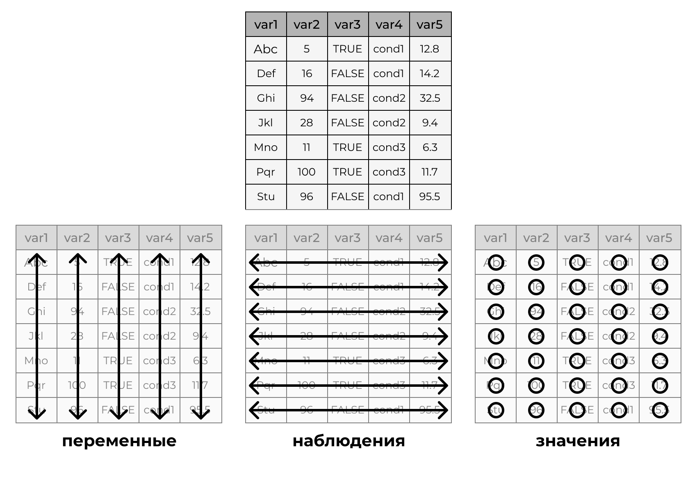
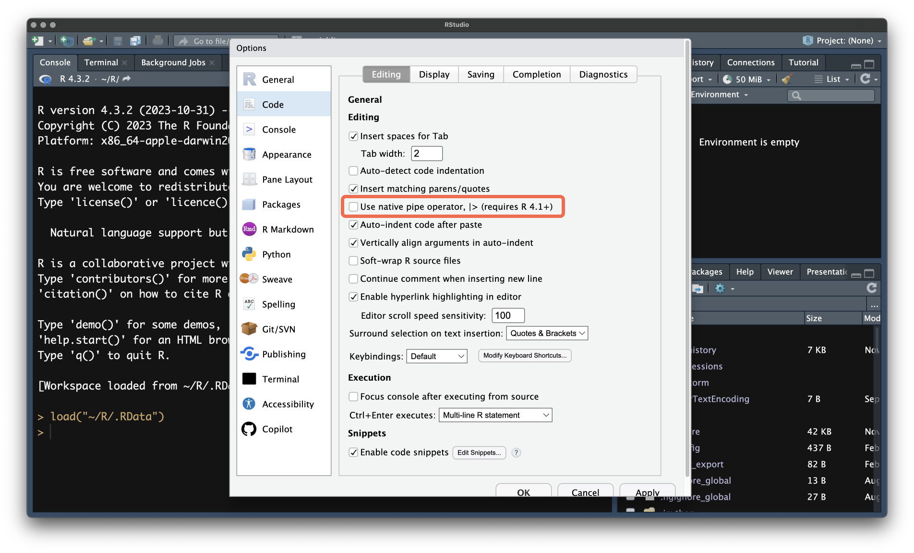

# Предобработка данных {#rpy-tidy}

```{r opts, echo=FALSE, eval=TRUE}
knitr::opts_chunk$set(echo = TRUE, eval = TRUE, warning = FALSE, message = FALSE, error = FALSE)
```

```{r pkgs, echo=FALSE}
library(tidyverse)
theme_set(theme_bw())
```

:::{.intro}
Мы научились читать данные и разглядывать их. Теперь нужно привести их в такой вид, чтобы с ними было удобно работать: выбросить лишнее, дать переменным понятные имена, выделить нужные наблюдения, создать новые переменные и сосчитать по ним первые сводки. Всё это называется **предобработкой данных** --- и это, как ни странно, самая трудоёмкая часть любого анализа.
:::


## Зачем предобрабатывать данные? {#tidy-why}

Данные приходят к нам из самых разных источников --- от экспериментальных программ, опросных платформ, электронных таблиц, баз данных. Каждый источник записывает данные по-своему. Одна и та же информация может быть записана десятком способов, и ни один из них заранее не будет удобен для вашего анализа.

В прошлой главе мы столкнулись с этим на данных эксперимента `sharexp`: в таблице было 91 столбец, большая часть которых для анализа не нужна, имена столбцов вроде `mouse_main1.time_raw` писать неудобно, а в конце таблицы затесались служебные строки, которые вообще не относятся к пробам.

Чтобы работать с любыми данными, независимо от того, откуда они пришли, их нужно привести к некоторому *стандартному* виду. Такой вид есть, и называется он **опрятными данными**.


## Опрятные данные {#tidy-concept}

:::{#def-tidy-data}
**Опрятные данные (tidy data)** --- это таблица, в которой

1. каждая **переменная** образует отдельный **столбец**,
2. каждое **наблюдение** образует отдельную **строку**,
3. каждое **значение** находится в отдельной **ячейке**.
:::

{#fig-tidy-data}

Звучит просто, но на практике нарушается постоянно. Например, в одной ячейке записаны сразу два значения (как в наших `pos1` --- `"[-238, 202]"` --- где в одной ячейке лежат обе координаты стимула), значения одной переменной «разъехались» по нескольким столбцам, а в одном столбце перемешаны разные переменные (как в нижней части наших файлов, где в первом столбце лежат *названия* переменных `age`, `date`, `session`, а во втором --- *значения*).

Понятие «наблюдение» определяется исследовательской задачей. В `sharexp` у нас одно наблюдение --- одна проба одного испытуемого: время до клика и координаты клика в этой пробе, тип пробы и т. д. Если же мы сравниваем испытуемых друг с другом, то наблюдением станет испытуемый. Одни и те же данные можно «собрать» по-разному, и мы научимся это делать.

Для приведения данных в опрятный вид и вообще для работы с данными в R существует целая экосистема пакетов.


## Семейство пакетов `tidyverse` {#tidy-tidyverse}

**`tidyverse`** --- это набор пакетов, построенных на общей философии и общем синтаксисе. Он содержит инструменты для всех этапов работы с данными: от импорта до визуализации.

Мы уже использовали `tidyverse` для чтения данных. Основные его пакеты:

|Пакет|Для чего нужен|
|:---|:---|
|`readr`|импорт данных из текстовых файлов|
|`tibble`|тибблы --- современные датафреймы|
|`dplyr`|преобразование таблиц: фильтрация, отбор столбцов, создание переменных, агрегация, объединение|
|`tidyr`|приведение данных к опрятному виду: смена формата, разделение и объединение столбцов, пропуски|
|`stringr`|работа со строками|
|`forcats`|работа с факторами|
|`lubridate`|работа с датой и временем|
|`purrr`|функциональное программирование|
|`ggplot2`|визуализация данных|

: Основные пакеты `tidyverse` {#tbl-tidyverse}

Установить пакет нужно один раз, а подключать его к сессии --- при каждом новом запуске R:

```{r tidyverse-install, eval=FALSE}
install.packages("tidyverse")  # один раз
library(tidyverse)             # в начале каждого скрипта
```

Данные первого испытуемого, как и в прошлой главе, загрузим в объект `d1`:

```{r read-d1}
d1 <- read_csv("data/sharexp/raw/01.csv", show_col_types = FALSE)
```


## Пайп {#tidy-pipe}

Прежде чем знакомиться с преобразованиями данных, познакомимся с оператором, без которого `tidyverse`-код немыслим, --- с **пайпом (pipe)**.

Пайп передаёт то, что стоит слева от него, в функцию справа **в качестве первого аргумента**:

```{r pipe-basic}
sum(1:3)
1:3 |> sum()
```

```{r pipe-basic2}
round(pi, 2)
pi |> round(2)
```

Выглядит как усложнение --- зачем писать больше? Дело в цепочках преобразований. Допустим, нужно извлечь корень из каждого числа вектора, найти среднее и округлить результат. Без пайпа получится «матрёшка», которую читать надо изнутри наружу:

```{r pipe-nested}
round(mean(sqrt(c(2, 4, 8, 16))), 2)
```

С пайпом то же самое читается слева направо и сверху вниз --- в том порядке, в котором выполняется:

```{r pipe-chain}
c(2, 4, 8, 16) |>
  sqrt() |>
  mean() |>
  round(2)
```

Теперь это можно прочитать вслух: «возьми числа, извлеки корень, найди среднее, округли до двух знаков». Именно так мы и будем писать преобразования данных. С одной-двумя функциями разница не слишком заметна, но цепочки из десяти шагов без пайпа превращаются в нечитаемый кошмар.

:::{.callout-note}
### Два вида пайпа

Существует два пайпа:

- **нативный** `|>` --- встроен в базовый R (начиная с версии 4.1);
- **магриттеровский** `%>%` --- из пакета `magrittr`, подключается вместе с `tidyverse`.

В большинстве случаев они взаимозаменимы, и мы будем использовать нативный. Но в чужом коде вы наверняка встретите `%>%`. Вводятся оба сочетанием клавиш `Ctrl + Shift + M` (`⌘ + Shift + M`); какой именно пайп будет вставлен, определяется настройкой `Tools → Global Options → Code → Use native pipe operator`.

{#fig-native-pipe}
:::

Если значение слева нужно передать не в первый аргумент, у нативного пайпа есть «заполнитель» `_`:

```{r pipe-placeholder}
2 |> round(x = pi, digits = _)  # значение слева попадёт в аргумент digits
```


## Отбор столбцов: `select()` {#tidy-select}

Первое, что мы сделаем с нашей таблицей, --- оставим только нужные столбцы. Для этого служит функция `select()`. Первый аргумент --- таблица (поэтому её удобно передавать пайпом), далее --- названия столбцов, которые мы хотим оставить:

```{r select-basic}
d1 |>
  select(numtrial, trialtype, setsize, mouse_main1.time_raw)
```

Названия пишутся без кавычек. Порядок столбцов в результате такой, как мы перечислили.

Для нашего анализа понадобятся:

- `numtrial` --- номер пробы в исходном файле с координатами;
- `trialtype` и `setsize` --- экспериментальные условия;
- `mouse_main1.time_raw`, `mouse_main1.x_raw`, `mouse_main1.y_raw` --- время до первого клика и его координаты;
- `mouse_main2.time_raw`, `mouse_main2.x_raw`, `mouse_main2.y_raw` --- то же для второго клика.

```{r select-needed}
d1 |>
  select(numtrial, trialtype, setsize,
         mouse_main1.time_raw, mouse_main1.x_raw, mouse_main1.y_raw,
         mouse_main2.time_raw, mouse_main2.x_raw, mouse_main2.y_raw)
```

Перечислять столбцы по одному утомительно. К счастью, у `select()` есть удобные «помощники»:

|Помощник|Что делает|
|:---|:---|
|`a:b`|все столбцы от `a` до `b` включительно|
|`-a`|все столбцы, кроме `a`|
|`starts_with("mouse")`|столбцы, названия которых начинаются на `mouse`|
|`ends_with("raw")`|столбцы, названия которых заканчиваются на `raw`|
|`contains("time")`|столбцы, в названиях которых есть `time`|
|`everything()`|все остальные столбцы|

: Помощники для выбора столбцов {#tbl-select-helpers}

```{r select-helpers}
d1 |> select(starts_with("mouse_main1"))   # все столбцы про первый клик
d1 |> select(contains("time_raw"))         # все столбцы со временем
d1 |> select(numtrial, ends_with("_raw"))  # номер пробы + все столбцы на _raw
```

Помощники можно комбинировать. Например, чтобы получить время и координаты обоих кликов, но без служебных столбцов со средними и стандартными отклонениями (`_mean`, `_std`), которые тоже пишет PsychoPy:

```{r select-combined}
d1 |>
  select(numtrial, trialtype, setsize,
         starts_with("mouse") & ends_with("_raw"))
```

Но в этом наборе ещё остались лишние столбцы: кнопки мыши (`leftButton_raw` и т. д.). Их можно убрать, добавив минус перед нужным помощником:

```{r select-minus}
d1 |>
  select(numtrial, trialtype, setsize,
         starts_with("mouse") & ends_with("_raw") & !contains("Button"))
```

Теперь у нас ровно те девять столбцов, которые нам нужны.


## Переименование столбцов: `rename()` {#tidy-rename}

Названия `mouse_main1.time_raw` писать неудобно. Переименуем столбцы с помощью функции `rename()`, которой нужно сказать `новое_имя = старое_имя`:

```{r rename-basic}
d1 |>
  select(numtrial, trialtype, setsize,
         starts_with("mouse") & ends_with("_raw") & !contains("Button")) |>
  rename(time1 = mouse_main1.time_raw,
         click1x = mouse_main1.x_raw,
         click1y = mouse_main1.y_raw,
         time2 = mouse_main2.time_raw,
         click2x = mouse_main2.x_raw,
         click2y = mouse_main2.y_raw)
```

Так будут называться наши переменные на протяжении всей дальнейшей работы:

- `time1` --- время до первого клика (с),
- `click1x`, `click1y` --- координаты первого клика (пиксели),
- `time2`, `click2x`, `click2y` --- то же для второго клика.

:::{.callout-tip}
Названия переменных лучше делать короткими, без пробелов и русских букв, в едином стиле. Названия с пробелами и специальными символами приходится заключать в обратные кавычки (`` `like this` ``) каждый раз, когда вы к ним обращаетесь.
:::

Когда нужно переименовать *все* столбцы разом, можно воспользоваться функцией `set_names()`, передав вектор новых имён в том же порядке. Если нужно применить к именам какую-то функцию (например, перевести в нижний регистр), на помощь придёт `rename_with()`:

```{r rename-with}
d1 |>
  select(trialtype, setsize) |>
  rename_with(toupper)
```


## Отбор строк: `filter()` и `slice()` {#tidy-filter}

Столбцы мы отобрали. Теперь отберём строки. Два основных инструмента:

- `slice()` отбирает строки **по номеру**;
- `filter()` отбирает строки **по условию**.

### Отбор по номеру строки {#tidy-slice}

Мы знаем, что проб было 450, а лишние строки находятся в конце. Отрежем их с помощью `slice()`:

```{r slice-basic}
d1 |>
  select(numtrial, trialtype, setsize, time1 = mouse_main1.time_raw) |>
  slice(1:450) |>
  tail(3)
```

(Заодно мы переименовали столбец прямо внутри `select()` --- так тоже можно.)

Такое решение работает, но у него есть недостаток: мы прописали в код число `450`. Если в какой-то файл попадёт другое число проб, код тихо вернёт неверный результат. Всегда лучше формулировать **условие**, а не номера строк.

Вспомогательные функции для отбора по номеру: `slice_head(n = 5)` --- первые 5 строк, `slice_tail(n = 5)` --- последние 5 строк, `slice_sample(n = 5)` --- пять случайных строк.

### Отбор по условию {#tidy-filter-cond}

Функция `filter()` оставляет только те строки, для которых условие истинно. Условия записываются через операторы сравнения, которые мы изучали в [основах R](rpy-basics.qmd#r-logic):

```{r filter-basic}
d1_small <- d1 |>
  select(numtrial, trialtype, setsize,
         time1 = mouse_main1.time_raw)

d1_small |> filter(time1 > 3)
```

Оставили пробы, в которых время до клика превышало 3 секунды. Условия можно комбинировать с помощью логических операторов:

- `&` --- «и» (нужно, чтобы выполнялись оба условия),
- `|` --- «или» (достаточно одного),
- `!` --- «не».

Если условия перечислены через запятую, они объединяются через «и».

```{r filter-logic}
d1_small |> filter(trialtype == "tray", setsize == 16)         # оба условия
d1_small |> filter(trialtype == "tray" | trialtype == "dots")  # одно из двух
d1_small |> filter(trialtype != "both")                        # всё, кроме both
```

Для проверки на принадлежность набору значений удобен оператор `%in%`:

```{r filter-in}
d1_small |> filter(setsize %in% c(12, 16))
```

А для попадания в интервал --- функция `between()`:

```{r filter-between}
d1_small |> filter(between(time1, 1, 1.5))
```

Теперь вернёмся к служебным строкам в конце файла. Мы знаем, что у них нет номера пробы --- там `NA`. Значит, настоящие пробы --- это те строки, где номер пробы **не** пропущен:

```{r filter-na}
d1_small |> filter(!is.na(numtrial)) |> nrow()
```

Ровно 450 строк. И никаких магических чисел в коде. Обратите внимание: сравнивать с `NA` оператором `==` бессмысленно (`x == NA` всегда даёт `NA`) --- для проверки на пропуск используется только `is.na()`.

:::{.callout-important}
В `tidyverse` внутри `filter()` и `select()` названия столбцов пишутся без кавычек, а значения текстовых переменных --- **в кавычках**. Если перепутать, получите либо ошибку «объект не найден», либо (что хуже) молча неверный результат.
:::

### Уникальные строки {#tidy-distinct}

Функция `distinct()` оставляет только уникальные комбинации значений. Это удобный способ посмотреть, какие значения вообще встречаются:

```{r distinct}
d1_small |>
  filter(!is.na(numtrial)) |>
  distinct(trialtype, setsize)
```


## Сортировка: `arrange()` {#tidy-arrange}

Функция `arrange()` сортирует таблицу по значениям одного или нескольких столбцов. По умолчанию --- по возрастанию; чтобы отсортировать по убыванию, нужно обернуть столбец в `desc()`:

```{r arrange}
d1_small |> filter(!is.na(numtrial)) |> arrange(time1)
d1_small |> filter(!is.na(numtrial)) |> arrange(desc(time1))
d1_small |> filter(!is.na(numtrial)) |> arrange(trialtype, desc(time1))
```

В последнем примере таблица сначала упорядочена по типу пробы, а внутри каждого типа --- по убыванию времени. В отличие от `sort()` из базового R, `arrange()` работает с целыми таблицами и переставляет строки целиком, не разрывая наблюдения.


## Создание и изменение переменных: `mutate()` {#tidy-mutate}

Часто нужных переменных в данных нет, но их можно получить из имеющихся. Для этого есть `mutate()`: слева от знака `=` --- имя новой (или изменяемой) переменной, справа --- как её вычислить. Подготовим «чистые» данные, на которых будем тренироваться:

```{r clean-d1}
d1_clean <- d1 |>
  filter(!is.na(numtrial)) |>
  select(numtrial, trialtype, setsize,
         starts_with("mouse") & ends_with("_raw") & !contains("Button")) |>
  rename(time1 = mouse_main1.time_raw,
         click1x = mouse_main1.x_raw,
         click1y = mouse_main1.y_raw,
         time2 = mouse_main2.time_raw,
         click2x = mouse_main2.x_raw,
         click2y = mouse_main2.y_raw)

d1_clean
```

Это та же цепочка, что и выше, только в логическом порядке: отобрали строки, отобрали столбцы, переименовали. Каждая строка --- один шаг, и всё прекрасно читается.

Теперь создадим новые переменные:

```{r mutate-basic}
d1_clean |>
  mutate(id = 1,                       # константа: id испытуемого
         time1_ms = time1 * 1000,      # время в миллисекундах
         fast = time1 < 1) |>          # логическая: быстрая ли проба
  select(id, numtrial, time1, time1_ms, fast)
```

Новые переменные добавляются справа. Если в `mutate()` указать имя уже существующего столбца, он будет перезаписан.

### Условные преобразования: `if_else()` и `case_when()` {#tidy-ifelse}

Часто новая переменная зависит от условия. Для условия с двумя исходами подходит `if_else()` (в базовом R --- `ifelse()`): первый аргумент --- условие, второй --- значение, если оно истинно, третий --- если ложно.

```{r if-else}
d1_clean |>
  mutate(speed = if_else(time1 < 1.5, "быстро", "медленно")) |>
  select(numtrial, time1, speed)
```

Когда исходов больше двух, используется `case_when()`: набор правил вида `условие ~ значение`, которые проверяются по очереди сверху вниз; для каждой строки срабатывает первое подошедшее правило.

```{r case-when}
d1_clean |>
  mutate(platform_icon = case_when(trialtype == "tray" ~ "iOS",
                                   trialtype == "dots" ~ "Android",
                                   trialtype == "both" ~ "обе")) |>
  count(trialtype, platform_icon)
```

Мы только что **перекодировали** переменную: вместо внутренних обозначений PsychoPy (`tray`, `dots`) получили понятные названия иконок. Подробнее о перекодировании категориальных переменных (в том числе в числа) поговорим в главе про [продвинутую предобработку](rpy-tidyadv.qmd).

Для числовых данных `case_when()` удобен ещё и для разбиения на категории:

```{r case-when-cut}
d1_clean |>
  mutate(time_cat = case_when(time1 < 1 ~ "< 1 с",
                              time1 < 2 ~ "1–2 с",
                              .default = "≥ 2 с")) |>
  count(time_cat)
```

Последнее правило с `.default` срабатывает для всех, кто не подошёл под предыдущие. Заметьте, что правило `time1 < 2` не нужно дополнять условием `time1 >= 1` --- до него доходят только те строки, которые не подошли под первое правило.

:::{.callout-warning}
Разбиение числовой переменной на категории --- это всегда потеря информации. Граница в 1 или 2 секунды здесь выбрана произвольно, исключительно в целях демонстрации. На практике так следует поступать, только если есть содержательные основания.
:::


## Агрегация данных {#tidy-summarise}

До сих пор мы работали на уровне отдельных проб. Но анализ редко ограничивается отдельными наблюдениями: обычно нам нужны сводные показатели --- например, среднее время поиска в разных условиях. Процесс вычисления сводных показателей по многим наблюдениям называется **агрегацией**.

### `summarise()`: сводка по всей таблице {#tidy-summarise-basic}

Функция `summarise()` сворачивает таблицу в одну строку со сводными показателями:

```{r summarise-basic}
d1_clean |>
  summarise(n = n(),                       # число строк
            mean_time = mean(time1),       # среднее время
            sd_time = sd(time1),           # стандартное отклонение
            median_time = median(time1))   # медиана
```

Функция `n()` считает количество наблюдений (строк).

### Агрегация по группам {#tidy-group}

Гораздо интереснее посчитать то же самое **по группам**: отдельно для каждого типа пробы или для каждого размера набора стимулов. Для этого нужно *сгруппировать* данные. Это можно сделать двумя способами.

Первый --- функция `group_by()`, которая «запоминает» группировку, а `summarise()` затем применяется к каждой группе по отдельности:

```{r group-by}
d1_clean |>
  group_by(trialtype) |>
  summarise(n = n(),
            mean_time = mean(time1),
            sd_time = sd(time1))
```

Второй --- аргумент `.by` прямо внутри `summarise()` (и `mutate()`, и `filter()`):

```{r by}
d1_clean |>
  summarise(n = n(),
            mean_time = mean(time1),
            sd_time = sd(time1),
            .by = trialtype)
```

Результат тот же, но группировка действует только внутри этой функции. С `group_by()` она «залипает» на таблице --- обычно вы это заметите по подписи `# A tibble: ... Groups: ...` в выводе, а чтобы её снять, нужно вызвать `ungroup()`. Поэтому для разовых действий удобнее `.by`.

Группировать можно по нескольким переменным сразу:

```{r by-two}
d1_clean |>
  summarise(n = n(),
            mean_time = mean(time1),
            .by = c(trialtype, setsize)) |>
  arrange(trialtype, setsize)
```

Девять групп --- по числу сочетаний условий. В каждой по 50 проб. Заметно, что при увеличении числа стимулов в пробе время поиска растёт --- как и можно было ожидать.

### Подсчёт числа наблюдений: `count()` {#tidy-count}

Для подсчёта частот есть специальный «ярлык» --- `count()`. Это то же самое, что `group_by()` + `summarise(n = n())`, но короче:

```{r count}
d1_clean |> count(trialtype)
d1_clean |> count(trialtype, setsize)
```

:::{.callout-note}
Теперь вместо `table()` из базового R мы можем получать такие же таблицы частот, но в формате тибблов, с которыми удобно работать дальше.
:::


## Собираем всё вместе {#tidy-together}

Мы научились выполнять отдельные операции. Настоящая сила `tidyverse` --- в том, что их можно соединять в одну цепочку. Вот полная предобработка данных одного испытуемого от «сырых» данных от PsychoPy до агрегированной сводки. Обратите внимание, как цепочка читается как рецепт:

```{r full-pipeline}
read_csv("data/sharexp/raw/01.csv", show_col_types = FALSE) |>
  filter(!is.na(numtrial)) |>                                  # убираем служебные строки
  select(numtrial, trialtype, setsize,
         starts_with("mouse") & ends_with("_raw") & !contains("Button")) |>
  rename(time1 = mouse_main1.time_raw,
         click1x = mouse_main1.x_raw,
         click1y = mouse_main1.y_raw,
         time2 = mouse_main2.time_raw,
         click2x = mouse_main2.x_raw,
         click2y = mouse_main2.y_raw) |>
  filter(trialtype != "both") |>                               # пробы с двумя целями анализируем отдельно
  mutate(id = 1) |>                                            # идентификатор испытуемого
  summarise(mean_time = mean(time1),
            sd_time = sd(time1),
            .by = c(id, trialtype, setsize))
```

Мы исключили пробы типа `both`, потому что в них две целевые иконки, и анализ таких проб отличается от анализа проб с одной целью. Из 450 проб осталось 300.

Результат мы получили для одного испытуемого. Но в нашем распоряжении двадцать --- и пока что этот код придётся копировать двадцать раз, меняя имя файла. Не очень-то красиво. В главе про [продвинутую предобработку](rpy-tidyadv.qmd) мы научимся читать и предобрабатывать все файлы сразу.


:::{.callout-note}
### Итоги

- **Опрятные данные**: переменная --- столбец, наблюдение --- строка, значение --- ячейка. К такому виду нужно привести данные перед анализом.
- **Пайп** `|>` передаёт результат слева в первый аргумент функции справа и превращает вложенные вызовы в читаемую цепочку.
- Основные глаголы `dplyr`:
    - `select()` --- отбор столбцов;
    - `rename()` --- переименование;
    - `filter()` и `slice()` --- отбор строк по условию и по номеру;
    - `arrange()` --- сортировка;
    - `mutate()` --- создание и изменение переменных (`if_else()` и `case_when()` --- для условных преобразований);
    - `summarise()` с `group_by()` или `.by` --- агрегация; `count()` --- подсчёт частот.
- Лучше формулировать **условия**, а не номера строк, и проверять результат каждого шага.
:::


:::{.intro}
В [прошлой главе](rpy-tidybase.qmd) мы научились приводить в порядок данные одного испытуемого. Но в эксперименте их двадцать, и данные о них разбросаны по нескольким файлам. Теперь наша цель --- собрать из всего этого единую таблицу, пригодную для анализа: прочитать все файлы, разобраться с пропусками, перекодировать переменные и объединить таблицы друг с другом.
:::


## Читаем все файлы сразу {#tidyadv-allfiles}

Список файлов мы уже получили в [главе про исследование данных](rpy-data.qmd#data-files):

```{r files}
files <- dir("data/sharexp/raw", full.names = TRUE)
length(files)
```

Первая мысль, которая приходит в голову, --- прочитать все файлы одной командой. Функция `read_csv()` умеет принимать вектор путей к файлам и склеивать их в одну таблицу. Попробуем:

```{r read-all-error, error=TRUE}
read_csv(files, id = "file", show_col_types = FALSE)
```

Ошибка! Функция жалуется, что в файлах разные названия столбцов в одних и тех же позициях. Хотя набор столбцов во всех файлах один и тот же, **порядок** столбцов в разных файлах разный --- в пяти файлах из двадцати столбцы расположены иначе. Это нормальная ситуация для реальных данных: в разное время и на разных компьютерах экспериментальная программа записывала столбцы в разном порядке.

Значит, придётся действовать иначе: прочитать и обработать каждый файл **по отдельности**, а затем объединить результаты. Склеивать таблицы мы будем «по именам» столбцов, а не по позициям, и порядок нам будет не важен.

### Пишем свою функцию {#tidyadv-functions}

Одну и ту же предобработку нужно повторить для двадцати файлов. Копировать один и тот же код двадцать раз --- плохая идея: если мы найдём ошибку, исправлять придётся в двадцати местах. Правильное решение --- обернуть код в **функцию**.

Мы уже пользовались готовыми функциями (`sqrt()`, `mean()`, `read_csv()`). Но можно создавать и свои. Устроена пользовательская функция так:

```{r function-syntax, eval=FALSE}
название_функции <- function(аргумент1, аргумент2) {
  # тело функции: код, который выполняется при вызове
  результат
}
```

- Слева от стрелки `<-` --- имя, под которым функция будет доступна (функция --- такой же объект R, как и вектор или таблица).
- Слово `function` с круглыми скобками, в которых перечислены **аргументы** --- то, что функция принимает на вход.
- В фигурных скобках --- **тело функции**: код, который выполнится при вызове функции.
- Значением функции становится результат **последнего** выражения в теле (или то, что передано в `return()`).

Простой пример: функция, которая переводит секунды в миллисекунды.

```{r function-example}
to_ms <- function(x) {
  x * 1000
}

to_ms(1.5)
to_ms(c(0.5, 1, 2))
```

Теперь превратим в функцию предобработку, которую мы разработали для первого испытуемого. На вход функция будет принимать путь к файлу, а возвращать --- аккуратную таблицу:

```{r preprocess-fn}
preprocess <- function(path) {
  read_csv(path, show_col_types = FALSE) |>
    filter(!is.na(numtrial)) |>
    select(numtrial, trialtype, setsize,
           starts_with("mouse") & ends_with("_raw") & !contains("Button")) |>
    rename(time1 = mouse_main1.time_raw,
           click1x = mouse_main1.x_raw,
           click1y = mouse_main1.y_raw,
           time2 = mouse_main2.time_raw,
           click2x = mouse_main2.x_raw,
           click2y = mouse_main2.y_raw) |>
    mutate(id = parse_number(basename(path)), .before = 1)
}
```

Все шаги знакомы нам по прошлой главе. Новое только в последней строке: нам нужно, чтобы в таблице был идентификатор испытуемого `id`, иначе после объединения мы не поймём, где чьи данные. Идентификатор мы берём из имени файла: `basename()` отбрасывает путь к папке (`"data/sharexp/raw/02.csv"` превращается в `"02.csv"`), а `parse_number()` извлекает из текста число (`"02.csv"` → `2`). Аргумент `.before = 1` помещает новый столбец на первое место.

Проверим функцию на втором файле:

```{r preprocess-test}
preprocess(files[2])
```

Работает: 450 строк (по числу проб), 10 столбцов, `id` равен 2.

### Применяем функцию ко всем файлам {#tidyadv-map}

Осталось применить функцию к каждому из двадцати путей. Для этого в пакете `purrr` (он входит в `tidyverse`) есть функция `map()`: она берёт вектор и функцию, применяет функцию к каждому элементу вектора и возвращает **список** результатов.

```{r map}
share_list <- map(files, preprocess)
length(share_list)    # список из 20 таблиц
class(share_list)
```

Получился список из двадцати таблиц. Чтобы «поставить их друг на друга», используем `list_rbind()` (от *row bind* --- «склеить по строкам»):

```{r list-rbind}
share <- share_list |> list_rbind()
share
```

Или одной цепочкой:

```{r map-chain, eval=FALSE}
share <- files |>
  map(preprocess) |>
  list_rbind()
```

Проверим результат. Должно получиться 20 × 450 = 9000 строк:

```{r share-check}
nrow(share)
share |> count(id)
```

У каждого испытуемого по 450 проб --- всё в порядке.

:::{.callout-note}
### Цикл вместо `map()`

То же самое можно сделать с помощью цикла `for`. Он последовательно перебирает элементы вектора и каждый раз выполняет одно и то же действие:

```{r for-loop, eval=FALSE}
share_loop <- tibble()                      # пустая таблица
for (f in files) {
  share_loop <- bind_rows(share_loop, preprocess(f))
}
```

Результат тот же. Цикл более «развёрнутый» и поэтому нагляднее для начинающих, а `map()` --- компактнее. Выбирайте то, что вам понятнее: в данных такого размера разница в скорости не имеет значения.
:::

Теперь у нас есть единая таблица `share` со всеми пробами всех испытуемых. Но кроме проб в файлах есть ещё и информация о самих испытуемых --- та самая, что хранится в служебных строках в конце файла.


## Данные об испытуемых: от длинного формата к широкому {#tidyadv-meta}

Вспомним, как выглядят служебные строки в конце файла:

```{r meta-raw}
read_csv(files[1], show_col_types = FALSE) |>
  filter(is.na(numtrial), !is.na(stim2)) |>
  select(key = stim1, value = stim2)
```

Здесь в первом столбце --- *название* показателя (возраст, дата, номер сессии…), во втором --- его *значение*. Так записывать данные об одном испытуемом удобно программе, но неудобно нам: это не опрятные данные. Переменные (`age`, `date`, …) должны быть **столбцами**, а у нас они лежат в **ячейках** первого столбца.

Сравните две формы записи одних и тех же данных:

|Форма|Что в ней|
|:---|:---|
|**Длинный формат (long)**|одна строка = одно значение одного показателя; названия показателей находятся в отдельном столбце|
|**Широкий формат (wide)**|одна строка = один объект; каждый показатель находится в своём столбце|

: Длинный и широкий форматы данных {#tbl-long-wide}

{#fig-wide-long}

Преобразовать длинный формат в широкий можно функцией `pivot_wider()`, широкий в длинный --- функцией `pivot_longer()` (обе из пакета `tidyr`). Начнём с `pivot_wider()`. Ей нужно сказать, из какого столбца брать названия новых столбцов (`names_from`) и из какого --- значения (`values_from`):

```{r pivot-wider-meta}
read_csv(files[1], show_col_types = FALSE) |>
  filter(is.na(numtrial), !is.na(stim2)) |>
  select(key = stim1, value = stim2) |>
  pivot_wider(names_from = key, values_from = value)
```

Получилась одна строка, где каждый показатель стал столбцом. Теперь оформим это в функцию и применим ко всем файлам, как мы это делали с пробами. Из служебной информации нам нужны только возраст и дата сессии, поэтому остальное отбросим сразу:

```{r read-meta}
read_meta <- function(path) {
  read_csv(path, show_col_types = FALSE) |>
    filter(is.na(numtrial), !is.na(stim2)) |>
    select(key = stim1, value = stim2) |>
    filter(key %in% c("age", "date")) |>
    pivot_wider(names_from = key, values_from = value) |>
    mutate(id = parse_number(basename(path)), .before = 1)
}

meta <- files |> map(read_meta) |> list_rbind()
meta
```

:::{.callout-important}
В служебных строках сырых данных иногда оказываются персональные данные --- имена, фамилии, e-mail. Для анализа они не нужны, поэтому мы берём из служебной информации только то, что нужно (`age` и `date`), и не тянем остальное в итоговую таблицу. Хорошая привычка --- «чистить» персональные данные как можно раньше и не публиковать их вместе с результатами.
:::

Посмотрим на получившуюся таблицу внимательно. Возраст записан как `<chr>` --- текст, хотя это число. Причина в том, что в одних файлах он записан как `19`, а в десятом --- как `18.0`, и в некоторых файлах он отсутствует вовсе (`NA`). Дата --- тоже текст, причём в разных форматах: `2019_Jan_14_1038` и `2019_01_14_1051`. С датами мы разберёмся в [следующей главе](rpy-strdt.qmd), а вот с возрастом и пропусками разберёмся прямо сейчас.


## Пропущенные значения {#tidyadv-na}

### Что такое пропуски и откуда они берутся {#tidyadv-na-what}

:::{#def-na}
**Пропущенное значение (missing value, `NA`)** --- отсутствующее значение переменной у конкретного наблюдения: мы знаем, что оно должно было быть, но его нет.
:::

Пропуски --- неотъемлемая часть реальных данных. Участник не ответил на вопрос, у прибора произошёл сбой, экспериментатор забыл записать значение, файл «склеился» с чем-то лишним, как это было в наших данных. Причины пропусков бывают разные, и это важно: **от причины зависит, что с пропуском делать**. Если пропуск вызван техническим мусором (как служебные строки), его просто убирают вместе со строкой. Если участник пропустил вопрос не случайно (например, избегал отвечать на неудобные вопросы), то простое удаление может исказить результаты анализа.

Разбираться с механизмами пропусков мы будем гораздо подробнее позднее. Пока важно научиться их находить и выполнять с ними базовые действия.

### Находим пропуски {#tidyadv-na-find}

Мы уже умеем проверять пропуски функцией `is.na()`. Посчитаем число пропусков в каждом столбце таблицы `meta`:

```{r na-colsums}
colSums(is.na(meta))
```

В возрасте три пропуска, в `id` и `date` --- ни одного. Какие это испытуемые?

```{r na-which}
meta |> filter(is.na(age))
```

Для широкой таблицы с большим числом столбцов удобно воспользоваться `across()` --- он позволяет применить одну и ту же функцию сразу к нескольким столбцам:

```{r na-across}
share |>
  summarise(across(everything(), ~ sum(is.na(.x))))
```

Запись `~ sum(is.na(.x))` --- это «безымянная» функция: тильда `~` говорит, что дальше идёт формула, а `.x` обозначает очередной столбец. Читается так: «для каждого столбца посчитай число пропусков». В основных данных пропусков нет --- мы убрали их ещё на этапе предобработки.

### Что делать с пропусками {#tidyadv-na-handle}

Есть три основных стратегии.

**1. Игнорировать пропуски при вычислении.** Большинство функций, которые работают с числами, по умолчанию возвращают `NA`, если в данных есть хотя бы один пропуск:

```{r na-mean}
meta <- meta |>
  mutate(age = as.numeric(age))   # переводим возраст из текста в число

mean(meta$age)
```

Чтобы посчитать среднее по имеющимся данным, нужно явно сказать функции об этом аргументом `na.rm = TRUE` (*NA remove*):

```{r na-rm}
mean(meta$age, na.rm = TRUE)
```

Это простое и честное решение: считаем по тем, у кого данные есть. Но важно помнить, что среднее теперь посчитано по 17 испытуемым, а не по 20.

**2. Удалить наблюдения с пропусками.** Для этого можно воспользоваться `filter(!is.na(...))` или специальной функцией `drop_na()`:

```{r drop-na}
meta |> drop_na(age) |> nrow()     # удаляем строки с пропуском в age
meta |> drop_na() |> nrow()        # удаляем строки с пропусками хоть в одном столбце
```

Удаление --- радикальное решение: вместе с пропуском теряется и вся остальная информация о наблюдении. Если удалить трёх испытуемых только из-за отсутствия возраста, мы потеряем данные ещё по 1350 пробам. Поэтому с удалением надо быть осторожным.

**3. Заменить пропуски значениями.** Заменить пропуск можно константой с помощью `replace_na()`:

```{r replace-na}
meta |>
  mutate(age_filled = replace_na(age, 0)) |>   # плохая идея, но смотрим как работает
  filter(id %in% c(14, 15, 16, 19))            # смотрим на двух испытуемых без пропусков и на пропуски
```

Здесь ноль в качестве возраста --- явная бессмыслица, и мы привели такой пример нарочно: **заменять пропуски нужно осмысленными значениями**, иначе вы испортите данные. Типичная замена --- на среднее арифметическое по остальным наблюдениям:

```{r replace-mean}
meta |>
  mutate(age_filled = replace_na(age, mean(age, na.rm = TRUE))) |>
  filter(id %in% c(14, 15, 16, 19))
```

Мы получили для трёх испытуемых возраст `19.35` --- дробный возраст, да ещё и одинаковый для всех троих. Такой подход называется *импутацией средним*. Он прост, но у него есть неприятные последствия: заменённые значения «стягиваются» к среднему и уменьшают вариативность данных, а значит, искажают всё, что с ней связано (стандартные отклонения, корреляции и т. д.). Существуют более аккуратные методы восстановления данных (множественная импутация и др.), но их разбор выходит за рамки нашего курса.

:::{.callout-warning}
Замена пропусков --- это всегда вмешательство в данные. Прежде чем это делать, подумайте, **почему** значения пропущены, и обязательно **укажите в отчёте**, что и как вы заменяли.
:::

В нашем эксперименте возраст --- не основная переменная. Мы оставим пропуски как есть и будем помнить о них, когда будем описывать выборку.


## Перекодирование переменных {#tidyadv-recode}

Мы часто сталкиваемся с ситуацией, когда переменная записана совсем не так, как нам нужно. Значения могут быть неинформативными (`andr` и `ios` вместо `Android` и `iOS`), текстовыми, когда нужны числа, или наоборот. Преобразование значений переменной в другой вид называется **перекодированием**. Мы уже сталкивались с ним в прошлой главе, когда `case_when()` превращал внутренние обозначения PsychoPy в названия иконок. Рассмотрим главные способы подробнее.

### Факторы {#tidyadv-factors}

В [основах R](rpy-basics.qmd#r-datatypes-factor) мы познакомились с типом `factor` --- типом данных для номинальных (и ранговых) переменных. Значения фактора называются **уровнями (levels)**. В отличие от обычного текста, у фактора фиксирован набор допустимых значений, и у них есть порядок.

Загрузим данные о платформе испытуемых и превратим `platform` в фактор:

```{r platform-factor}
platform <- read_delim("data/sharexp/share_platform.csv", delim = " ", show_col_types = FALSE)

platform |>
  mutate(platform = factor(platform,
                           levels = c("ios", "andr"),         # какие значения бывают и в каком порядке
                           labels = c("iOS", "Android"))) |>  # как их назвать
  head(5)
```

Аргумент `levels` задаёт порядок уровней, а `labels` --- их новые названия. Порядок уровней важен, потому что именно по нему расположатся категории на графиках и в таблицах, а при построении статистических моделей первый уровень станет **референсным** (базовым, с которым сравниваются все остальные).

Переименовать уровни у уже готового фактора можно функцией `fct_recode()` из пакета `forcats`, а поменять порядок --- `fct_relevel()`:

```{r fct-recode}
platform |>
  mutate(platform = factor(platform)) |>                       # по умолчанию уровни по алфавиту
  mutate(platform = fct_recode(platform,
                               "Android" = "andr",
                               "iOS" = "ios")) |>              # новое = старое
  mutate(platform = fct_relevel(platform, "iOS")) |>           # iOS теперь первый уровень
  pull(platform) |>
  levels()
```

Функция `pull()` «вытаскивает» столбец из таблицы как вектор.

### Кодирование категорий числами: label encoding {#tidyadv-label-enc}

Многие методы анализа (особенно в машинном обучении) работают только с числами. Самый простой способ превратить категории в числа --- пронумеровать их. Такой подход называется **label encoding**.

Фактор в R внутри хранится именно так --- как набор целых чисел, каждое из которых соответствует уровню. Достать эти числа можно с помощью `as.integer()`:

```{r label-encoding}
d_types <- tibble(trialtype = c("tray", "dots", "both", "tray")) |>
  mutate(trialtype_fct = factor(trialtype, levels = c("tray", "dots", "both")),
         trialtype_num = as.integer(trialtype_fct))
d_types
```

Здесь у нас появилась «арифметика», которой нет в исходных данных: `both` оказывается «больше» `dots`, а `dots` --- «больше» `tray`. Для номинальных переменных, где категории не упорядочены, это не имеет смысла. Поэтому label encoding уместен только когда у категорий действительно есть порядок (ранговая переменная), или когда алгоритм, который мы собираемся использовать, это допускает.

### Бинарные индикаторы: one-hot encoding {#tidyadv-onehot}

Если категории неупорядочены, но числа нужны, используют **one-hot encoding** («горячее кодирование»): для каждой категории создаётся отдельный бинарный столбец, в котором `1` означает «наблюдение принадлежит этой категории», а `0` --- «не принадлежит». Мы уже встречались с таким способом, когда создавали логическую переменную с условием: достаточно превратить её в число.

```{r onehot}
d_types |>
  mutate(is_tray = as.integer(trialtype == "tray"),
         is_dots = as.integer(trialtype == "dots"),
         is_both = as.integer(trialtype == "both"))
```

Для переменной с $k$ категориями достаточно $k - 1$ индикаторов: по нулям во всех остальных столбцах третья категория определяется однозначно. В статистических моделях (регрессии, дисперсионном анализе) R делает такое кодирование за нас автоматически --- мы увидим это позже. Но иногда, например при подготовке данных для алгоритмов машинного обучения, это нужно уметь делать руками.

Сделать то же самое сразу для всех уровней можно функцией `model.matrix()`:

```{r model-matrix}
model.matrix(~ 0 + trialtype_fct, data = d_types)
```

`~ 0 + trialtype_fct` --- это формула: «закодируй переменную `trialtype_fct`, без свободного члена» (о формулах мы будем говорить в главах про регрессию). Нам важно лишь то, что получилась та самая матрица из нулей и единиц.


## Объединение таблиц {#tidyadv-join}

Данные нашего эксперимента лежат в разных таблицах:

- `share` --- пробы (много строк на каждого испытуемого);
- `meta` --- возраст и дата сессии (одна строка на испытуемого);
- `platform` --- платформа смартфона (одна строка на испытуемого);
- `targets` --- координаты целевых стимулов (одна строка на пробу).

Чтобы анализировать зависимость времени поиска от платформы или посчитать точность клика, эту информацию нужно собрать в одну таблицу. Таблицы можно объединять по-разному.

### Простое «склеивание»: `bind_rows()` и `bind_cols()` {#tidyadv-bind}

Если у таблиц одинаковые столбцы, их можно «поставить друг на друга» с помощью `bind_rows()`. Если у таблиц одинаковое число строк, идущих в одном порядке, их можно «поставить рядом» через `bind_cols()`. Мы уже пользовались первым способом, когда склеивали результаты предобработки двадцати файлов (`list_rbind()` --- это то же самое для списка таблиц).

`bind_cols()` на практике применяют реже: он полагается на то, что строки в таблицах идут в одинаковом порядке, а это легко нарушить. Гораздо надёжнее соединять таблицы **по ключу**.

### Объединение по ключу {#tidyadv-key}

:::{#def-key}
**Ключ (key)** --- переменная (или набор переменных), по значениям которой строки одной таблицы сопоставляются со строками другой.
:::

Например, и в `meta`, и в `platform` есть столбец `id` --- номер испытуемого. По нему мы и можем узнать, что строка с `id = 1` в одной таблице и строка с `id = 1` в другой относятся к одному и тому же человеку.

Для начала разберёмся на игрушечных таблицах. Пусть у нас есть две таблицы `x` и `y`:

```{r toy-xy}
x <- tibble(id = c(1, 2, 5, 7),
            var1 = c("Abc", "Def", "Mno", "Stu"),
            var2 = c(5, 16, 11, 96))

y <- tibble(id = 1:4,
            var3 = c("cond1", "cond1", "cond2", "cond2"),
            var4 = c(12.8, 14.2, 32.5, 9.4))

x
y
```

Ключ в них --- `id`. Обратите внимание: в `x` есть `id` = 5 и 7, которых нет в `y`, а в `y` --- `id` = 3 и 4, которых нет в `x`. Общими оказались только `id` = 1 и 2. Что делать с необщими строками? От ответа на этот вопрос зависит, какая именно функция объединения нужна.

{#fig-xy}

**`inner_join()`** --- оставляет только те строки, ключ которых есть **в обеих** таблицах.

{#fig-inner-join}

```{r inner-join}
inner_join(x, y, by = "id")
```

**`left_join()`** --- оставляет **все** строки левой таблицы (`x`), а из правой подтягивает то, что находит. Для строк, у которых пары нет, значения из правой таблицы будут `NA`.

{#fig-left-join}

```{r left-join}
left_join(x, y, by = "id")
```

**`right_join()`** --- то же самое, но наоборот: оставляются все строки правой таблицы.

{#fig-right-join}

```{r right-join}
right_join(x, y, by = "id")
```

**`full_join()`** --- оставляет **все** строки обеих таблиц; где нет пары, там `NA`.

{#fig-full-join}

```{r full-join}
full_join(x, y, by = "id")
```

Эти четыре функции называются **присоединяющими (mutating joins)**: они добавляют столбцы из одной таблицы в другую. Есть ещё две, **фильтрующие (filtering joins)**: они ничего не добавляют, а только отбирают строки.

**`semi_join()`** --- оставляет строки левой таблицы, для которых **нашлась** пара в правой.

{#fig-semi-join}

```{r semi-join}
semi_join(x, y, by = "id")
```

**`anti_join()`** --- оставляет строки левой таблицы, для которых пары в правой **не нашлось**. Это незаменимый инструмент проверки: «кто из `x` потерялся в `y`?».

{#fig-anti-join}

```{r anti-join}
anti_join(x, y, by = "id")
```

Все шесть способов можно изобразить на диаграммах Эйлера --- Венна, где левый круг --- таблица `x`, правый --- таблица `y`, а закрашено то, что попадает в результат:

{#fig-joins-venn}

:::{.callout-important}
### Дубли в ключе

Что если в ключе есть повторяющиеся значения? Тогда каждая строка с одним значением ключа в одной таблице будет сопоставлена **каждой** строке с таким же ключом в другой, и число строк в результате вырастет. Так, если в `x` два наблюдения с `id = 1`, а в `y` два с `id = 2`:

```{r duplicate-keys}
x_dup <- bind_rows(x, tibble(id = 1, var1 = "Abc", var2 = 7)) |> arrange(id)
y_dup <- bind_rows(y, tibble(id = 2, var3 = "cond2", var4 = 2.0)) |> arrange(id)

left_join(x_dup, y_dup, by = "id")
```

Число строк выросло с 5 (в `x_dup`) до 6. Это самый частый источник тихих ошибок при объединении. Поэтому **всегда сравнивайте число строк до и после объединения** и проверяйте, что ключ уникален там, где вы этого ожидаете: `count(x_dup, id)`.

{#fig-duplicate-keys}
:::

Если ключи в таблицах называются по-разному, то их можно сопоставить явно: `by = c("id_x" = "id_y")`. Если ключ состоит из нескольких переменных, их перечисляют в векторе: `by = c("id", "numtrial")`.

### Объединяем данные эксперимента {#tidyadv-join-sharexp}

Вернёмся к нашим данным. Сначала присоединим к проботам информацию об испытуемых. Таблица `share` --- «левая», потому что мы хотим сохранить **все** пробы; `meta` и `platform` содержат по одной строке на испытуемого.

Сначала соберём «таблицу испытуемых»:

```{r join-subjects}
subjects <- meta |>
  left_join(platform, by = "id")
subjects
```

Заметьте: обе таблицы содержат по 20 строк, ключ `id` встречается ровно один раз в каждой. Число строк не изменилось.

Теперь присоединяем «таблицу испытуемых» к таблице проб:

```{r join-share}
nrow(share)

share <- share |>
  left_join(subjects, by = "id")

nrow(share)
```

Число строк не изменилось (9000 до и после), значит, дублей ключа не было и ничего не потерялось. Посмотрим на результат:

```{r join-share-view}
share |>
  select(id, numtrial, trialtype, setsize, time1, age, platform)
```

Теперь для каждой пробы известна платформа смартфона испытуемого.

### Точность ответа: объединяем с координатами целевых стимулов {#tidyadv-accuracy}

Время до клика мы получили прямо из данных. Но нас интересует и **точность** поиска: попал ли испытуемый кликом по целевому стимулу или промахнулся. Для этого нужно сопоставить координаты клика с координатами целевой иконки в этой пробе --- а они хранятся в `targetpositions.xlsx`.

Прочитаем таблицу с координатами. В ней есть столбцы, относящиеся к тренировочной серии (в их названии есть суффикс `tr`), и лишние строки без номера пробы. Нам они не нужны:

```{r targets}
targets <- readxl::read_xlsx("data/sharexp/targetpositions.xlsx") |>
  select(!ends_with("tr")) |>     # убираем столбцы тренировочной серии
  drop_na(numtrial)               # убираем строки без номера пробы

targets
```

Для каждой пробы (`numtrial`) здесь указаны координаты целевого стимула и диапазоны (`posxmin1`, `posxmax1`, `posymin1`, `posymax1`), в пределах которых клик считается попаданием. Если в пробе два целевых стимула (`both`), то вторые координаты (`posx2`, `posxmin2`, …) задают положение второй цели; в остальных пробах там стоят «заглушки» --- одинаковые значения для области, в которой стимулов нет.

Ключ здесь --- `numtrial`: номер пробы в исходном файле. Присоединяем:

```{r join-targets}
share <- share |>
  left_join(targets, by = "numtrial")

nrow(share)
```

И снова 9000 строк. Теперь для каждой пробы известны не только время и координаты клика, но и допустимые диапазоны. Клик считается правильным, если по обеим осям попал в диапазон хотя бы одной из целей. Проверим это с помощью `between()` и логических операторов:

```{r accuracy}
share <- share |>
  mutate(hit1 = between(click1x, posxmin1, posxmax1) & between(click1y, posymin1, posymax1),
         hit2 = between(click1x, posxmin2, posxmax2) & between(click1y, posymin2, posymax2),
         correct = hit1 | hit2)

share |>
  summarise(accuracy = mean(correct),
            .by = trialtype)
```

Вспомним, что `TRUE` при вычислениях превращается в `1`, а `FALSE` --- в `0`, поэтому среднее логического вектора --- это доля `TRUE`, то есть доля правильных ответов. Во всех типах проб точность около 98–99%. Мы получили вторую зависимую переменную эксперимента.

Теперь уберём вспомогательные столбцы, которые нам больше не понадобятся, и оставим только те, что нужны для анализа:

```{r share-final}
share <- share |>
  select(id, age, platform, date, numtrial, trialtype, setsize,
         time1, click1x, click1y, correct)

share
```

В итоге у нас получилась опрятная таблица: одна строка --- одна проба одного испытуемого; в столбцах --- идентификатор и характеристики испытуемого, условия пробы, время реакции, координаты клика и правильность ответа.


## Агрегация и сводные таблицы {#tidyadv-pivot}

Проанализировать 9000 проб --- не то же самое, что проанализировать 20 испытуемых. Во многих задачах нам нужно сначала посчитать **сводные показатели по каждому испытуемому** (например, его среднее время поиска в каждом условии), а затем работать с ними.

Пробы типа `both` содержат два целевых стимула, и анализировать их придётся иначе. Пока отфильтруем их и посчитаем среднее время по испытуемым и условиям:

```{r agg}
share_agg <- share |>
  filter(trialtype != "both") |>
  summarise(mean_time = mean(time1),
            sd_time = sd(time1),
            accuracy = mean(correct),
            .by = c(id, platform, trialtype, setsize))

share_agg
```

Получилось 20 испытуемых × 2 типа проб × 3 размера набора = 120 строк. Это *длинный* формат: в каждой строке одно сочетание условий.

### Из длинного формата в широкий {#tidyadv-to-wide}

Для некоторых методов анализа (например, для расчёта корреляции между условиями) условия должны быть в **разных столбцах**. Превратим длинную таблицу в широкую так, чтобы среднее время в каждом размере набора стимулов стало отдельным столбцом:

```{r pivot-wider}
share_wide <- share_agg |>
  select(id, platform, trialtype, setsize, mean_time) |>
  pivot_wider(names_from = setsize,
              values_from = mean_time,
              names_prefix = "setsize_")

share_wide
```

Аргумент `names_prefix` добавляет префикс к именам новых столбцов (названия столбцов, состоящие только из цифр, неудобны).

Такая таблица --- это уже *сводная таблица*: по строкам --- условия и испытуемые, по столбцам --- значения показателя в зависимости от размера набора.

### Из широкого формата в длинный {#tidyadv-to-long}

И обратно. Для построения графиков и многих моделей нужен как раз **длинный** формат. Функция `pivot_longer()` собирает несколько столбцов в два: один с названиями исходных столбцов (`names_to`), другой --- с их значениями (`values_to`):

```{r pivot-longer}
share_wide |>
  pivot_longer(cols = starts_with("setsize_"),
               names_to = "setsize",
               names_prefix = "setsize_",
               names_transform = as.numeric,
               values_to = "mean_time")
```

Мы вернулись в исходный вид. Так что одну и ту же информацию мы можем представить в том формате, который удобен для конкретной задачи.

:::{.callout-note}
Если не уверены, какой формат вам нужен, ориентируйтесь на правило опрятных данных. Если переменные «разъехались» по столбцам --- вам нужен `pivot_longer()`. Если значения одной переменной лежат в разных строках --- вам нужен `pivot_wider()`.
:::


## Сохраняем результат {#tidyadv-export}

Мы проделали большую работу: прочитали двадцать файлов, привели их в порядок, разобрались с пропусками, объединили с остальными таблицами. Повторять её каждый раз, когда нужно сделать новый анализ, неразумно. Лучше сохранить результат в файл.

Для сохранения таблицы в текстовые форматы есть функции с префиксом `write_`:

```{r write, eval=FALSE}
write_csv(share, "data/sharexp/share_clean.csv")        # CSV (запятая)
write_csv2(share, "data/sharexp/share_clean2.csv")      # «европейский» CSV
write_delim(share, "data/sharexp/share_clean.txt", delim = "\t")
writexl::write_xlsx(share, "data/sharexp/share_clean.xlsx")  # Excel (пакет writexl)
```

Теперь по умолчанию, когда нам понадобится обработанный набор, достаточно будет его прочитать:

```{r read-clean, eval=FALSE}
share <- read_csv("data/sharexp/share_clean.csv")
```

:::{.callout-important}
Сохранять обработанные данные нужно в **новый** файл. Исходные («сырые») файлы не перезаписываем никогда. Код, который ведёт от сырых данных к обработанным, сохраняем в скрипте --- так предобработку всегда можно повторить и проверить.
:::


:::{.callout-note}
### Итоги

- Если данные разбросаны по многим файлам, **оберните предобработку одного файла в функцию** и примените её ко всем файлам с помощью `map()` и склейте результат `list_rbind()`.
- **Длинный формат** (`pivot_longer()`) и **широкий формат** (`pivot_wider()`) --- два способа представления одних и тех же данных. Формат выбирается под задачу.
- **Пропуски**: находим (`is.na()`, `colSums()`), игнорируем (`na.rm = TRUE`), удаляем (`drop_na()`) или осмысленно заменяем (`replace_na()`). Всегда сначала выясняем **причину** пропусков.
- **Перекодирование**: факторы (`factor()`, `fct_recode()`), label encoding (`as.integer()` от фактора), one-hot encoding (логические индикаторы или `model.matrix()`).
- **Объединение таблиц по ключу**: `inner_join()`, `left_join()`, `right_join()`, `full_join()` добавляют столбцы; `semi_join()` и `anti_join()` отбирают строки. После объединения **всегда проверяйте число строк**.
- Результат предобработки сохраняем в **новый** файл (`write_csv()`), а исходные данные не трогаем.
:::


